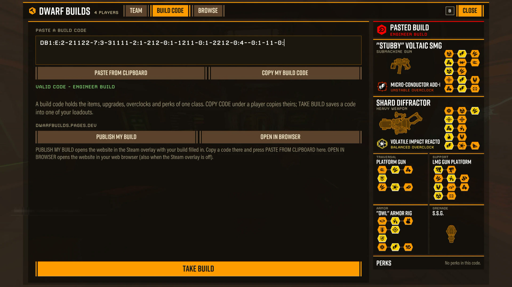
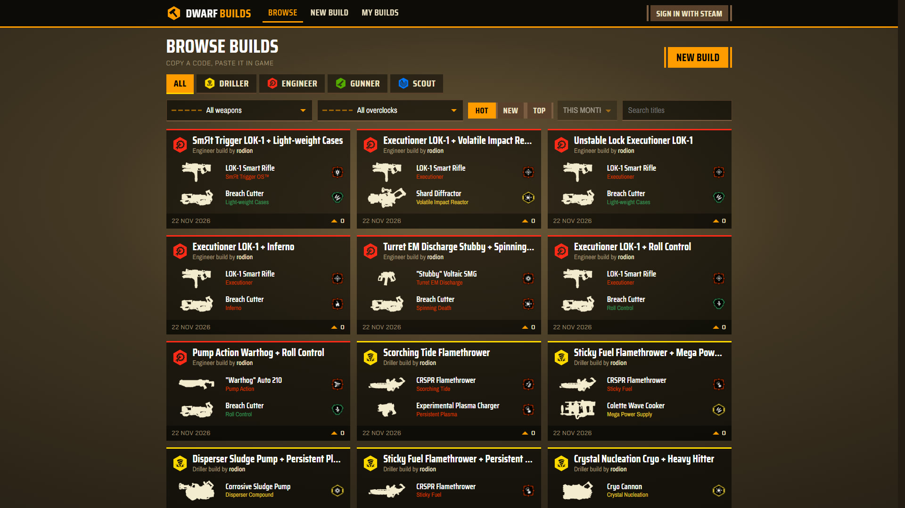

# Dwarf Builds

[](https://github.com/byrodi/dwarf-builds-drg/releases/latest)
[](LICENSE)

Deep Rock Galactic mod: see your whole team's builds in game and share them as build codes.

Builds are shared on the Dwarf Builds website, [byrodi/dwarf-builds-web](https://github.com/byrodi/dwarf-builds-web),
included here as the `Web` submodule.


## Features

- Every player's weapons, upgrades, overclocks, equipment and perks in one window, opened from the Dwarf Builds
  page of [Mod Hub](https://mod.io/g/drg/m/mod-hub) (or Elytras Mod Manager, which lists Mod Hub mods too).
- The class selection screen shows your team's builds next to yours.
- Copy any build as a short code, or paste one to preview it.
- TAKE BUILD saves a code into one of your loadouts, using only what you own.
- BROWSE opens the build website in the Steam overlay.
- Client-side: other players do not need the mod.

The game does not send a client other players' perks, and only part of their upgrades. When the host runs the mod
too, every player who has it shares their full build and perks with everyone; players without it show what the
game sends. Lobbies can mix this build, the mod.io release (0.1.0 or 0.2.0) and players without the mod.

## Screenshots

**The window.** One column per player: weapons with every upgrade tier, overclocks, equipment and perks,
with tooltips in the game's style.


**TAKE BUILD.** Save a teammate's build into one of your loadout slots; only what you own is applied.


**Build codes.** Paste a code on the BUILD CODE tab, check the preview, then take it.



**The website.** Find and share builds on the Dwarf Builds website ([source](https://github.com/byrodi/dwarf-builds-web)); BROWSE opens it
in the Steam overlay.



## Installation

Build it from source (below) and add the pak to [mint](https://github.com/trumank/mint) as a local mod, together
with a Mod Hub: [Mod Hub](https://mod.io/g/drg/m/mod-hub) or Elytras Mod Manager. The window opens only from the
hub's menu. The upstream release is on [mod.io](https://mod.io/g/drg/m/dwarf-builds).

## Usage

| Key or button | What it does |
| --- | --- |
| Elytras Mod Manager's hub → Dwarf Builds | The mod's page: every player's builds, shown as soon as it opens. |
| Team | Everyone in the lobby, one column per player; past four players, filter by class. |
| Build code | Paste a code, preview it, take it into a loadout, copy or publish your own. |
| Browse builds | The website in the Steam overlay. |

Copy a code on the website, then press Paste from clipboard on the Build code tab. This build's page is made of
Elytras Mod Manager's widgets, so it needs EMM installed.

## Building from source

The mod is C++ compiled to cooked Blueprints by [AssetGen](https://github.com/Elytras/CPP-to-blueprint-compiler)
(the sources are in `Mod/DwarfBuilds`, see [NOTES.md](NOTES.md)). No Unreal editor or project is needed. You need:

- AssetGen, built as its README says (Windows: `AssetGen.sln`, Release x64; Linux: CMake), with LLVM clang 20 on
  `PATH` and Python 3 with `pyyaml`.
- The game's API as C++ headers with Elytras Mod Manager's (`IHubLook`, `BasicButton`, its `Widget` service), which
  the hub page is made of: ue-mods' `BpMods/UeApi`. [DRG-Blueprint-Cpp-SDK](https://github.com/Elytras/DRG-Blueprint-Cpp-SDK)'s
  `experimental/UeApi` has the game's but not EMM's.
- `UnrealPak.exe` from Unreal Engine 4.27 (on `PATH` or in `UNREALPAK`) to pack the pak.

```
git clone https://github.com/Elytras/CPP-to-blueprint-compiler.git AssetGen
git clone <this repository> dwarf-builds-drg
python AssetGen/tools/bpbuild.py dwarf-builds-drg/Mod <ue-mods>/BpMods/UeApi AssetGen/x64/Release/assetgen.exe
```

The pak lands in `Mod/out/DwarfBuilds_P.pak`; add it to [mint](https://github.com/trumank/mint) as a local mod.
The build refuses to pack when the replicated surface differs from the one 0.1.0 shipped (`Mod/netcontract.json`),
so a lobby can mix this build and the mod.io release.

The logo texture ships as the one cooked for 0.1.0 (`Mod/Bundle`), since AssetGen does not write textures. Its
source is `Tools/dwarfbuilds/art`.

The website's game data comes from the installed game: `python Tools/dwarfbuilds_export.py --game <DRG folder>`
reads the game's pak with UnrealPak (set `UNREALPAK`) and writes `Web/public/data` and `Web/public/img`.

## Credits

The idea and the window layout come from [Build Inspector](https://mod.io/g/drg/m/build-inspector) by
AssemblyStorm. Dwarf Builds is a remake with its own assets and code.

## License

[MIT](LICENSE)
